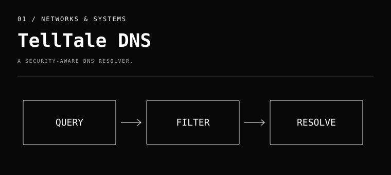
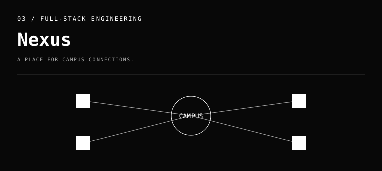
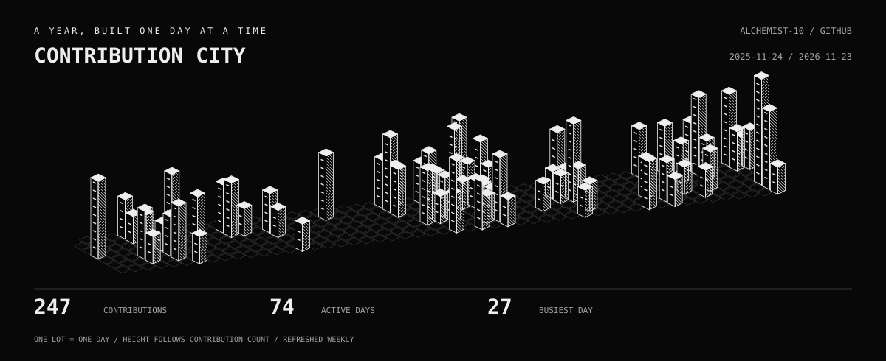

  

  <strong>Third-year CSE student · AI &amp; Data Science · IIIT Kottayam</strong> 
  I build machine learning systems, data pipelines, and reliable backend tools.

  <a href="https://www.linkedin.com/in/akshay-vs-84381131a/">LinkedIn</a> &nbsp; / &nbsp;
  <a href="mailto:akshaykailath2020@gmail.com">Email</a>

---

### Selected builds

<table>
<tr>
<td width="50%" valign="top">

<h3>TellTale DNS</h3>

A multithreaded DNS resolver with caching, security filtering, tunneling detection, and audit logging.

<strong>~36K QPS in a local cache-hit benchmark · 23 end-to-end checks</strong>

C++17 · UDP sockets · Multithreading · Linux

<a href="https://github.com/Alchemist-10/Telltale-DNS">Explore the repository →</a>
</td>
<td width="50%" valign="top">

<h3>TurbFormer</h3>

Image restoration under atmospheric turbulence, combining physics-based training data with a Swin Transformer model.

<strong>30K+ generated samples · DDP/FSDP training</strong>

Python · PyTorch · Computer vision

<a href="https://github.com/Alchemist-10/turbformer">Explore the research →</a>
</td>
</tr>
<tr>
<td width="50%" valign="top">

<h3>Nexus</h3>

A campus collaboration and mentorship platform, with relational data, validated APIs, search, and session workflows.

Next.js · TypeScript · PostgreSQL · Supabase

<a href="https://github.com/Alchemist-10/nexus_submitted">Repository →</a> &nbsp; <a href="https://nexus-landing-alpha.vercel.app/">Live site ↗</a>
</td>
<td width="50%" valign="top">
<h3>Also on the workbench</h3>

<a href="https://github.com/Alchemist-10/XEngine"><strong>XEngine ↗</strong></a> Concurrent document collection and search over 5K+ documents, with BM25 ranking and a Flask API. C++ · Python · Retrieval

<a href="https://github.com/Alchemist-10/SynkIndia"><strong>SyncIndia ↗</strong></a> Audio/video preprocessing and lip-sync generation across three Indian languages. PyTorch · OpenCV · FFmpeg

</td>
</tr>
</table>

### Tools I work with

| Area | Tools |
| :--- | :--- |
| **AI & data** |         Python, PyTorch, Hugging Face, scikit-learn, pandas, NumPy, Matplotlib, LangChain |
| **APIs & applications** |       FastAPI, Flask, Node.js, Next.js, React, TypeScript |
| **Storage & infrastructure** |         PostgreSQL, SQLite, Redis, Docker, Azure, Linux, Git, GitHub Actions |

### A year, built one day at a time

<picture>
  <source media="(prefers-color-scheme: dark)" srcset="assets/contribution-city-dark.svg" />
  <source media="(prefers-color-scheme: light)" srcset="assets/contribution-city-light.svg" />
  
</picture>

---

**Currently exploring:** dependable data workflows, multimodal ML, and backend performance. 
Open to **AI/ML, data automation, and backend engineering internships**. 
<a href="mailto:akshaykailath2020@gmail.com">Let's build something useful →</a>
