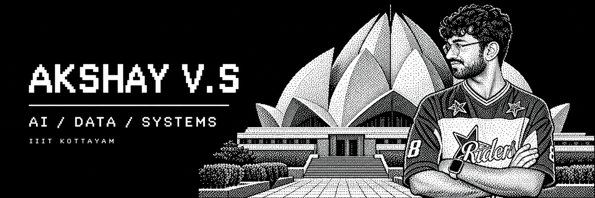
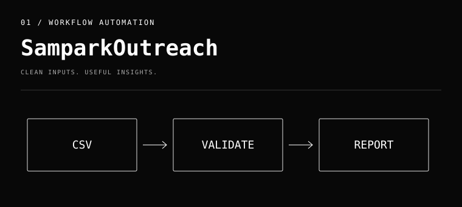
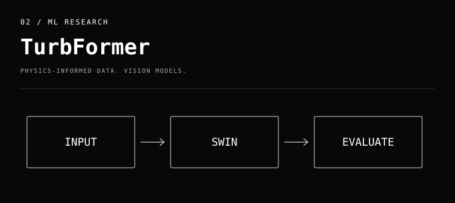

  

  <strong>Third-year CSE student · AI &amp; Data Science · IIIT Kottayam</strong> 
  I build machine learning systems, data pipelines, and reliable backend tools.

  <a href="https://www.linkedin.com/in/akshay-vs-84381131a/">LinkedIn</a> &nbsp; / &nbsp;
  <a href="mailto:akshaykailath2020@gmail.com">Email</a> &nbsp; / &nbsp;
  <a href="https://leetcode.com/u/Akshay_VS/">LeetCode</a>

---

### A little context

- **Research:** AI/ML internships at **Amity University (USRF)** and **NIT Goa**, spanning image restoration, data generation, model evaluation, and explainability.
- **Engineering:** Backend internship at **CM&S** — Python APIs, PostgreSQL, validation, documentation, and deployment to Azure.
- **Problem solving:** **Knight on LeetCode** · **HAC'KP2026 finalist**, Kerala Police Cyberdome.

### Selected builds

<table>
<tr>
<td width="50%" valign="top">

<h3>SamparkOutreach</h3>

Event and outreach reporting with validated CSV pipelines, duplicate protection, aggregate analytics, and privacy-aware exports.

<strong>22 tests · Windows/Linux CI · synthetic demo</strong>

Python · pandas · FastAPI · SQLite

<a href="https://github.com/Alchemist-10/SamparkOutreach">Explore the repository →</a>
</td>
<td width="50%" valign="top">

<h3>TurbFormer</h3>

Image restoration under atmospheric turbulence, combining physics-based training data with a Swin Transformer model.

<strong>30K+ generated samples · DDP/FSDP training</strong>

Python · PyTorch · Computer vision

<a href="https://github.com/Alchemist-10/turbformer">Explore the research →</a>
</td>
</tr>
<tr>
<td width="50%" valign="top">

<h3>Nexus</h3>

A campus collaboration and mentorship platform, with relational data, validated APIs, search, and session workflows.

Next.js · TypeScript · PostgreSQL · Supabase

<a href="https://github.com/Alchemist-10/nexus_submitted">Repository →</a> &nbsp; <a href="https://nexus-landing-alpha.vercel.app/">Live site ↗</a>
</td>
<td width="50%" valign="top">
<h3>Also on the workbench</h3>

<a href="https://github.com/Alchemist-10/Telltale-DNS"><strong>TellTale DNS ↗</strong></a> A multithreaded DNS resolver with caching, filtering, tunneling detection, and audit logging. C++17 · UDP · Linux

<a href="https://github.com/Alchemist-10/XEngine"><strong>XEngine ↗</strong></a> Concurrent document collection and search over 5K+ documents, with BM25 ranking and a Flask API. C++ · Python · Retrieval

<a href="https://github.com/Alchemist-10/SynkIndia"><strong>SyncIndia ↗</strong></a> Audio/video preprocessing and lip-sync generation across three Indian languages. PyTorch · OpenCV · FFmpeg

</td>
</tr>
</table>

### Tools I work with

| Area | Tools |
| :--- | :--- |
| **AI & data** | Python, PyTorch, Hugging Face, scikit-learn, pandas, NumPy, Matplotlib, LangChain |
| **APIs & applications** | FastAPI, Flask, Node.js, Next.js, React, TypeScript |
| **Storage & infrastructure** | PostgreSQL, SQLite, Redis, Docker, Azure, Linux, Git, GitHub Actions |

### Chapters so far

| When | Where / what |
| :--- | :--- |
| **2024–2028** | B.Tech, Computer Science & Engineering (AI & Data Science), IIIT Kottayam |
| **May–Aug 2026** | Backend engineering internship, CM&S |
| **May–Jun 2026** | ML research internship, NIT Goa |
| **Jun–Jul 2026** | Fully funded AI research internship, USRF at Amity University |

### A year, built one day at a time

<picture>
  <source media="(prefers-color-scheme: dark)" srcset="assets/contribution-city-dark.svg" />
  <source media="(prefers-color-scheme: light)" srcset="assets/contribution-city-light.svg" />
  
</picture>

Actual contribution counts, not simulated activity. Updated weekly with GitHub Actions. <a href="data/contributions.json">View the data</a> · <a href="scripts/render_city.py">How it is drawn</a>

---

**Currently exploring:** dependable data workflows, multimodal ML, and backend performance. 
Open to **AI/ML, data automation, and backend engineering internships**. 
<a href="mailto:akshaykailath2020@gmail.com">Let's build something useful →</a>
